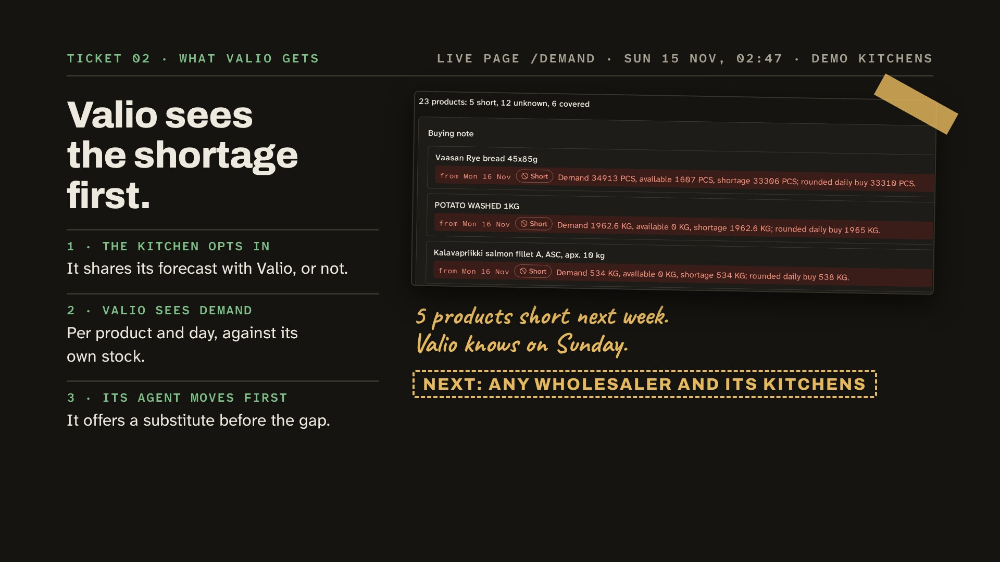
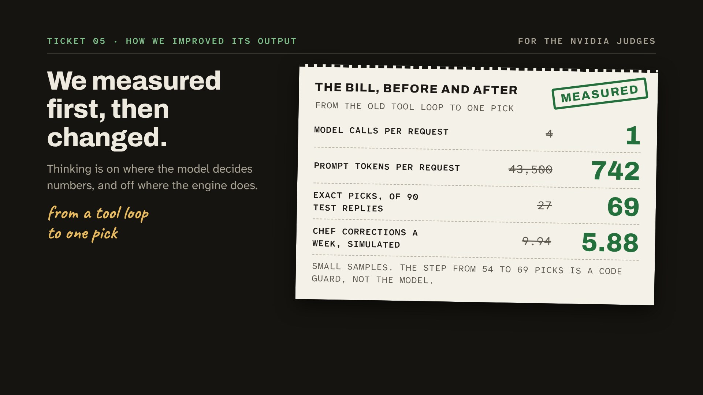
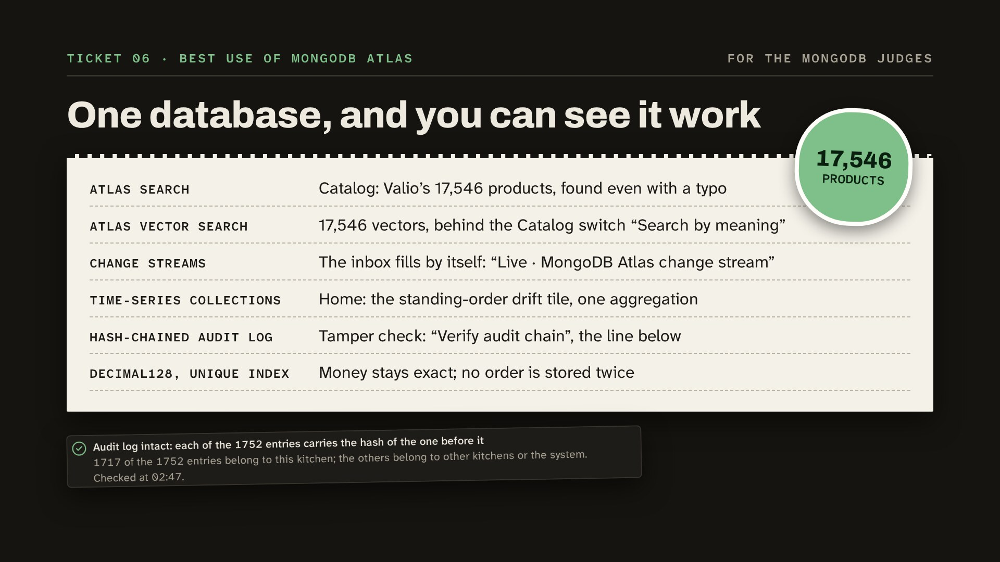

# Pitch deck

The deck we show at Junction 2026 after the live demo. Twelve slides: two before the demo, eight
after it, two backup pictures for when the live site does not answer.

- **All slides in one file:** [`kitchen-buyer-pitch.pdf`](kitchen-buyer-pitch.pdf) (works offline).
- **Demo video, 1:57:** <https://youtu.be/7Wu0xuCiUHI>
- **Live site:** <https://kitchenbuyer.pl> (the old address <https://31-22-104-201.sslip.io> keeps working).
- **Demo script:** [`../demo.md`](../demo.md). **Form text and the source of every claim:** [`../submission.md`](../submission.md).

The slides were made on 15 Nov 2026 at about 03:00 Helsinki. Prices, stock and counts on the live
site move, so in the demo read today's numbers from the screen.

## The run: five minutes per visitor

1. Slide 1, one sentence.
2. Slide 2, the problem, 20 seconds.
3. The live demo, three minutes (`docs/demo.md`, story A).
4. Back to the deck for what the demo did not show.
   - Peer reviewers and Valio judges: slides 3, 4, 8, 9 and 10, about 1 minute 40.
   - NVIDIA judges: add slides 5 and 6. MongoDB judges: add slide 7.
5. End on slide 10 and leave it on screen.

If the live demo cannot run, play the video, or use slides 11 and 12.

## The slides and what to say

### 1. Cover

> Hi, we are 2BROTHERS, and this is Kitchen Buyer. An agent proposes the order. A person signs it.

The ticket is the real order of 15 Nov: 698 pieces of lactose-free milk, EUR 2,099.41, signed at
00:18, nothing sent to the supplier.

### 2. The problem

> Sunday night. The kitchen is out of milk, and everybody thought somebody else ordered it. Today a
> buyer logs into a webshop and searches a catalog by hand. Valio Aimo serves twenty thousand
> kitchens that work like this. And Valio asked one thing: let an agent do the buying, safely and
> in the open, before somebody else's platform decides how. This is their own example. Let me type
> it.

Then the live demo. The picture of the three of us is AI-generated; it is a frame of the clip that
opens the demo video.

### 3. What Valio gets

> That last page is what Valio gets. A restaurant chooses whether Valio may see its forecast, and
> it can switch that off again. With it, Valio sees what all those kitchens will need, per product
> and day, against its own stock, before a single order comes in. Here: five products will run
> short next week, and Valio knows on Sunday. Its own agent then offers a substitute first. So the
> restaurant gets a buyer, and Valio gets the demand signal. And the same open interface could
> serve any wholesaler and its kitchens.

If asked: the demand comes from 20 demo kitchens with a synthetic history. Valio Aimo is the only
real supplier today, so "any wholesaler" is the next step and not built; that is why its stamp is
dashed.

### 4. What you just saw

> What you just saw, in one line. Nemotron chooses the products. Plain code sets every quantity and
> every total. A person approves the exact total. And three things are refused by code, not by a
> prompt: an agent that tries to approve its own order, a yes for a price that has moved, and
> peanut butter in a kitchen that bans peanuts.

### 5. Nemotron: one model, five jobs

> In the demo Nemotron bought, and on Valio's side it sold. The same model does three more jobs. It
> reads a menu photo into a plan. It counts a shelf from one photo: seven products in under a
> second, and the pack it cannot see gets "please count", not a guess. And it reads a delivery note
> and finds ninety-one euros to claim. Five jobs, one model, and it never sets a quantity, a price
> or a total.

If asked: the photos are prepared test photos, and we did not train or fine-tune the model.

### 6. How we improved its output

> We measured before we tuned. The Buyer used to be a tool loop: about four model calls and 43,500
> prompt tokens for one request. Now it is one call and 742 tokens. A ranked prompt and a code
> guard took exact picks from 27 to 69 out of 90 test replies. And when the kitchen's own
> corrections go in as memory, a simulated chef corrects 41 percent less.

If asked: three live requests per row for calls and tokens; the 30-request set is a development
set, not held-out; 54 of 90 is the model alone and the step to 69 is code; the chef is synthetic.

### 7. MongoDB Atlas

> All of it runs on MongoDB Atlas. Two parts you just saw: the inbox fills by itself over a change
> stream, and the log you verified is insert-only and hash-chained. Two you did not: Atlas Search
> finds the right milk in 17,546 products, even with a typo, and a unique index means no order is
> ever stored twice.

If asked: vector search is real and sits behind the Catalog switch; the Buyer searches by words and
uses the vectors only when the words find nothing.

### 8. Any client can be the buyer

> And it is not only our web page. The gateway is an MCP server and a REST API, so any agent can
> talk to it: Claude, Codex, a hotel chain's own agent. It can search and propose. It cannot
> approve. And we built a Telegram bot: a cook speaks the order into the phone, the way he would
> tell the purchaser, and gets the proposal back. Here the bot heard "oak drink", and it still
> proposed the oat drink. Approval stays with a person, on our approval card.

### 9. Honest limits

> Three honest limits. No order reaches Valio: their challenge API has no order call, so our
> receipt says "not sent". Sign-in is built and switched off for judging, so every visitor is the
> approver. And Valio is the only real supplier; the learned facts on the Settings page are sample
> data.

If asked about the audit log: say "a cut or rewritten end is detected against a head record", not
"anchored". The head record is not signed yet (#1886).

### 10. The ask

> We cooked: eleven hundred pull requests since Friday evening. Now you. Open the site, there is no
> sign-in. Type your own order, and try to make the agent approve it.

1,100 is pull requests opened, rounded. On 15 Nov at 02:26 Helsinki GitHub counted 1,111 opened, of
which 988 merged. Do not say "merged" for 1,100. Count again:
`gh api "search/issues?q=repo:Afro666/2Brothers+is:pr" --jq .total_count`.

### 11 and 12. Backup

Slide 11 is the demo's milk request as one picture: 698 L confirmed, 302 L waits, EUR 2,099.41
approved. By hand in a webshop we estimate five to ten minutes for this order; that is an estimate,
nobody timed it. Slide 12 is the signed receipt and the hash-chained log.

## The source

`src/` holds the deck as it was written: `deck.json` (the order of the slides and the typefaces),
`deck.css` (the look) and one HTML file per slide in `src/slides/`. Each slide's `<aside>` holds
the full speaker notes with the source of every number on it. The deck was built as a Claude Slides
artifact, where pictures are stored by id; the same pictures are in `src/img/`:

| In the slide HTML | File in `src/img/` | What it is |
|---|---|---|
| `/_blob/fdcd43d5…` | `d-point.jpg` | AI-generated picture of the team, slide 2 |
| `/_blob/6a4c0de2…` | `d-demand.png` | The live Demand page, 15 Nov 02:47 |
| `/_blob/a0cc9bb4…` | `d-homestrip.png` | "Who decides what" from the Home page |
| `/_blob/5088f999…` | `d-shelf.png` | The prepared shelf test photo |
| `/_blob/bb021e02…` | `d-noteline.png` | The delivery claim line |
| `/_blob/67e4cbdc…` | `d-trustline.png` | The tamper check result, 15 Nov 02:47 |
| `/_blob/96af32ce…` | `telegram.png` | The Telegram bot, 14 Nov 20:27 |
| `/_blob/23deeb79…` | `cooks.jpg` | AI-generated picture of the team, slide 10 |
| `/_blob/2b4d4f59…` | `option-a.png` | The milk proposal card, 15 Nov 00:03 |
| `/_blob/b32bdeac…` | `receipt.png` | The signed receipt, 15 Nov 00:18 |

The look follows the product's own design direction: paper dockets, printer type, stamps, and
dashed ochre for what is not there yet.
