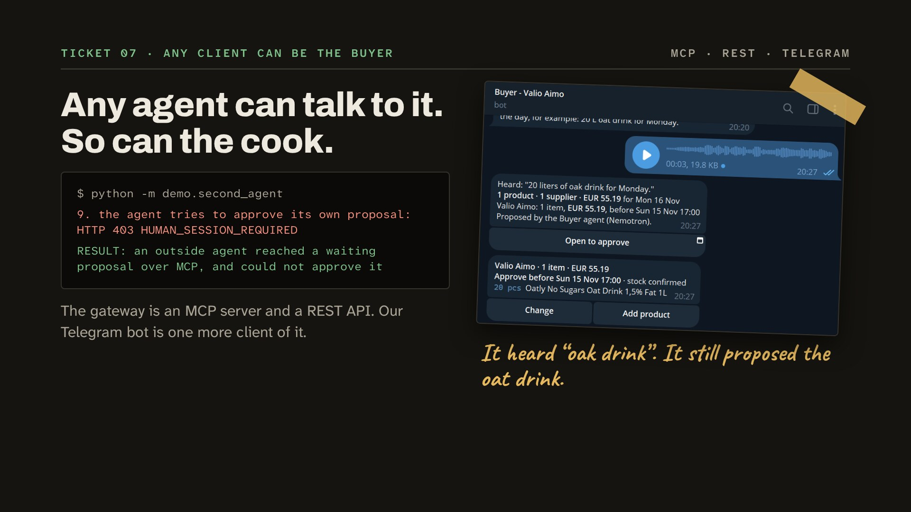
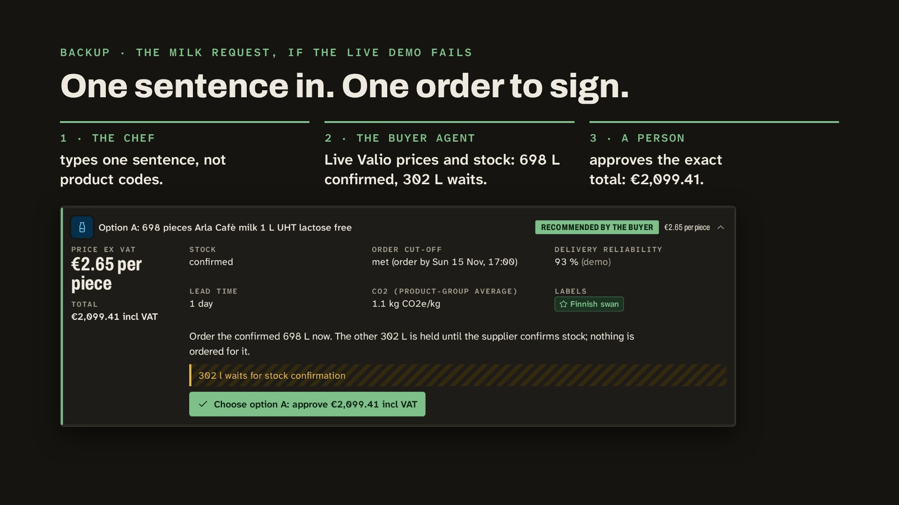
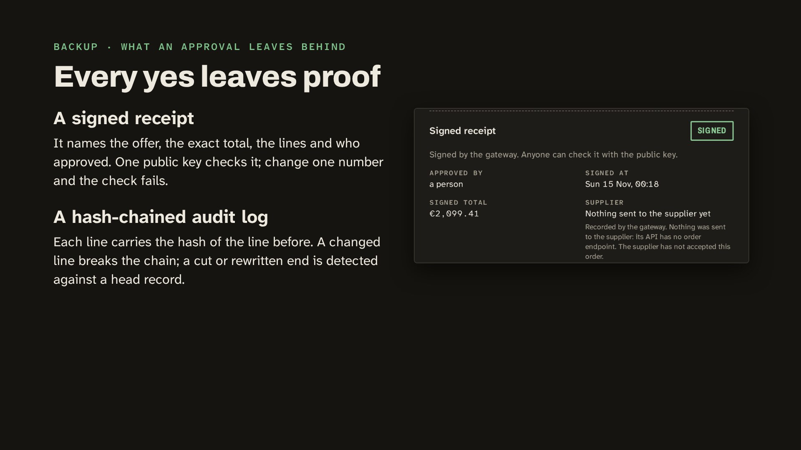

# Pitch deck

The deck we show at Junction 2026 after the demo video. Twelve slides: a cover, the problem (only
before a live demo), eight slides for what the video has no time for, and two backup pictures.

- **All slides in one file:** [`kitchen-buyer-pitch.pdf`](kitchen-buyer-pitch.pdf) (works offline).
- **Demo video, 1:57:** <https://youtu.be/7Wu0xuCiUHI>
- **Live site:** <https://kitchenbuyer.pl> (the old address <https://31-22-104-201.sslip.io> keeps working).
- **Demo script:** [`../demo.md`](../demo.md). **Form text and the source of every claim:** [`../submission.md`](../submission.md).

The slides were made on 15 Nov 2026 between 03:00 and 04:30 Helsinki. Prices, stock and counts on
the live site move, so read today's numbers from the screen.

## The run: five minutes per visitor

| Time | What |
|---|---|
| 0:00 | Slide 1. "Hi, we are 2BROTHERS, this is Kitchen Buyer. Two minutes of video first." |
| 0:10 | The demo video, 1:57. Say nothing. |
| 2:10 | "Here is what the video had no time for." |
| 2:15 | Five slides, about 1 minute 30: 3 (Valio), 4 (the rule), 8 (open), 9 (honest), 10 (close) |
| 3:45 | A question, or the visitor tries the site |

- Skip slide 2: the video opens with the same scene. Use it only before a live demo.
- NVIDIA judges: add slides 5 and 6. MongoDB judges: add slide 7. All eight slides take 2 minutes
  40 and leave no time for a question.
- If the time is cut: slide 9, then slide 10.
- A judge who wants it live: `docs/demo.md`, story A, with slide 2 before it.

One word per slide is enough to remember the order: **Valio, Rule, Five, Measured, Atlas, Open,
Honest, Close.**

Two facts to say the same way everywhere:

- The audit log is tamper-evident: a changed entry or a truncated end is detected. The head is not
  signed yet (#1886), so do not say "anchored".
- An order is recorded, never "sent": nothing goes to the supplier.

## The slides and what to say

Under each slide: what to say, then the extra lines for a Valio, NVIDIA or MongoDB judge. The
sponsor lines add 15 to 25 seconds each, so use them on the slides that are theirs: Valio on 3, 4
and 9; NVIDIA on 5 and 6; MongoDB on 7.

### 1. Cover

> Hi, we are 2BROTHERS, and this is Kitchen Buyer. An agent proposes the order. A person signs it. Two minutes of video first.

- **Valio:** It runs on your challenge data: your catalog, your prices, your stock.
- **NVIDIA:** The agent you will see is Nemotron 3.5 Super VL.
- **MongoDB:** Everything you will see is stored in MongoDB Atlas.

### 2. The problem (only before a live demo)

> Sunday night. The kitchen is out of milk, and everybody thought somebody else ordered it. Today a buyer logs into a webshop and searches a catalog by hand. Valio Aimo serves twenty thousand kitchens that work like this. And Valio asked one thing: let an agent do the buying, safely and in the open, before somebody else's platform decides how. This is their own example. Let me type it.

- **Valio:** This sentence is your own example from the challenge.

### 3. VALIO: what Valio gets

> The video showed the kitchen's side. This is Valio's side. A kitchen can share its forecast with Valio, or not. Then Valio sees the demand against its own stock, before any order comes in. Five products short next week, and Valio knows on Sunday.

- **Valio:** Your own agent then offers a substitute first. So the restaurant gets a buyer, and you get the demand signal. We built this tool for you too. And the same open interface could serve any wholesaler and its kitchens. These are twenty demo kitchens with a synthetic history, built from your real products and prices.
- **NVIDIA:** The buying note on this page is written by Nemotron, and every number in it is checked against its row in the table.
- **MongoDB:** The forecasts behind this page are a time-series collection in Atlas, more than forty thousand rows.

### 4. RULE: what you just saw

> The rule behind everything you saw. The model picks the products. Code sets every quantity and every total. A person approves the exact total. And code refuses three things: an agent approving its own order, a price that moved, and peanuts in a peanut-free kitchen.

- **Valio:** This is the guardrails model you asked for. Today the agent decides nothing alone. Auto-approve exists and is off: a kitchen has to earn it with four weeks and twenty of its own decisions.
- **NVIDIA:** Nemotron gets a numbered shortlist and answers in a strict JSON schema. A pick outside the shortlist is refused, and so is a reason with a number that is not in the data.
- **MongoDB:** One yes covers exactly one order: a unique index in Atlas returns the stored order when the same request comes twice.

### 5. FIVE: Nemotron's jobs

> One model, five jobs. It plans from a menu photo. It buys. It sells, on Valio's side. It counts a shelf from a photo. And it reads a delivery note. What it cannot match, it does not guess. And it never sets a quantity or a price.

- **NVIDIA:** The buy job is one model call, thinking off, with a strict JSON reply. Code does every tool step, and the model has no approve tool. If it does not answer, a plain parser makes the proposal and the card says so. We did not fine-tune it, and the photos are prepared test photos.
- **Valio:** The selling agent on your side is the same model. It reads your shortage view and offers a substitute. It sends no price and no quantity.

### 6. MEASURED: how we improved its output

> We measured before we tuned. One request was four model calls and 43,500 prompt tokens. Now it is one call and 742. A better prompt took the model's exact picks from 27 to 54 out of 90, and a code guard took them to 69. And a simulated chef corrects 41 percent less.

- **NVIDIA:** These are prompt tokens per request. The samples are small: three live requests per row, and thirty test requests run three times. The step from 54 to 69 is code, not the model. And the kitchen memory is computed facts in the prompt, not fine-tuning.
- **Valio:** This is why code sets your quantities: we tested the model on numbers, and the engine won.

### 7. ATLAS: MongoDB Atlas

> All of it runs on MongoDB Atlas. The catalog search is Atlas Search over 17,546 products. The inbox fills live, over a change stream. The audit log is hash-chained. And no order is ever stored twice.

- **MongoDB:** Atlas Search is one index over English, Finnish and Swedish names, and it allows one typo. Vector Search has 17,546 voyage-4 vectors behind the Catalog switch; the Buyer uses it only when the words find nothing. Stock, deliveries and forecasts are time-series collections, and the drift tile is one aggregation with setWindowFields. Money is Decimal128.
- **Valio:** Your whole catalog, 17,546 products, is searchable in English, Finnish and Swedish.
- **NVIDIA:** The vectors are MongoDB's voyage-4, not Nemotron: our endpoint serves no embedding model.

### 8. OPEN: any client can be the buyer

> It is open. Any agent can connect over MCP or REST. It can search and propose. It cannot approve. And the cook can just talk to a Telegram bot. It heard "oak drink", and it still proposed the oat drink.

- **Valio:** This is the open interface you asked for: an agent card, an llms.txt, OpenAPI and MCP. A buyer's agent uses it with a kitchen token, and it can check our signed offers with one public key, without asking us.
- **NVIDIA:** The bot has no model of its own. Voice becomes text with Whisper on our server, and then Nemotron reads the text.

### 9. HONEST: the limits

> What is not real yet. No order reaches Valio, because their test API has no order call. Sign-in is built and switched off for judging. And Valio is the only real supplier; the rest is demo data.

- **Valio:** The next step is on your side: an order call and a supplier confirmation. Our signed receipt already names the offer, the exact total, the lines and who approved.
- **NVIDIA:** The photos Nemotron reads here are prepared test photos, not real phone photos.
- **MongoDB:** The end of the audit log is checked against a head record, and that head is not signed yet.

### 10. CLOSE: the ask

> So: the agent proposes, a person signs. Three of us and our coding agents cooked eleven hundred pull requests in two days. Now you. Open kitchenbuyer dot P L, ask for a hundred litres of cream, and try to make the agent approve it.

- **Valio:** Or type your own example: a thousand litres of lactose-free milk by Monday.
- **NVIDIA:** Open "What Nemotron did" on any card: it shows the model call and every code step.
- **MongoDB:** Open Reports, Tamper check, and press "Verify audit chain".

### 11. Backup: the milk request

> The chef types one sentence. About fifteen seconds later there is one proposal with live Valio prices and stock. Valio had 698 litres confirmed, so the card does not pretend: order the confirmed part now, hold the other 302. A person approved exactly 2,099 euros and 41 cents.

- **Valio:** By hand in your webshop we estimate five to ten minutes for this order. That is our estimate; nobody timed it.

### 12. Backup: the proof

> Every approved order gets a signed receipt: the offer, the exact total, the lines, and who approved. Anyone can check it with one public key. And every step is in a hash-chained log: a changed entry or a truncated end is detected. The receipt also says plainly that nothing was sent to the supplier.

- **Valio:** This is the trust protocol you asked about: a signed offer and a signed receipt that your side or the buyer's side can check without us.
- **MongoDB:** The log is insert-only in Atlas. Change one line and the chain breaks at that line.

Notes that are not spoken:

- Slide 10: invite cream, oat drink, chicken breast, cheese or lactose-free milk. Do not invite butter,
  eggs or salmon as a free request: those three still give the wrong kind of product (`docs/demo.md`).
- Slide 10: 1,100 is pull requests opened, rounded (1,111 opened and 988 merged on 15 Nov at 02:26
  Helsinki). Do not say "merged" for it.
- Slide 7: say "even with a typo" only if you type the typo in front of the judge.
- Slide 6: the video's "almost eight times fewer tokens" counts completion tokens on the old loop
  (2,251 to 289); the slide counts prompt tokens per request.

## Questions a visitor may ask

- **Does it really order?** It records a signed order. Valio's test API has no order call, so
  nothing is sent, and the receipt says so.
- **Why not let the model set quantities?** We measured it: no model reached our engine on the
  benchmark, so the engine keeps the numbers.
- **What if the model is wrong or down?** A wrong pick cannot become a wrong order: code sizes it
  and a person approves. If the model is down, a plain parser answers and the card says so.
- **What is real?** Valio's prices, stock and catalog are their challenge data, read live. The
  kitchens' history and the other suppliers are demo data.
- **What next?** A real order call from Valio, and the same interface for other wholesalers.

## The source

`src/` holds the deck as it was written: `deck.json` (the order of the slides and the typefaces),
`deck.css` (the look) and one HTML file per slide in `src/slides/`. Each slide's `<aside>` holds
what to say, with the extra lines for Valio, NVIDIA and MongoDB. The source of every number is in
`docs/submission.md`; the first version of `src/slides/` in this folder's history carried the
sources per slide. The deck was built as a Claude Slides
artifact, where pictures are stored by id; the same pictures are in `src/img/`:

| In the slide HTML | File in `src/img/` | What it is |
|---|---|---|
| `/_blob/fdcd43d5…` | `d-point.jpg` | AI-generated picture of the team, slide 2 |
| `/_blob/6a4c0de2…` | `d-demand.png` | The live Demand page, 15 Nov 02:47 |
| `/_blob/a0cc9bb4…` | `d-homestrip.png` | "Who decides what" from the Home page |
| `/_blob/5088f999…` | `d-shelf.png` | The prepared shelf test photo |
| `/_blob/bb021e02…` | `d-noteline.png` | The delivery claim line |
| `/_blob/67e4cbdc…` | `d-trustline.png` | The tamper check result, 15 Nov 02:47 |
| `/_blob/96af32ce…` | `telegram.png` | The Telegram bot, 14 Nov 20:27 |
| `/_blob/23deeb79…` | `cooks.jpg` | AI-generated picture of the team, slide 10 |
| `/_blob/2b4d4f59…` | `option-a.png` | The milk proposal card, 15 Nov 00:03 |
| `/_blob/b32bdeac…` | `receipt.png` | The signed receipt, 15 Nov 00:18 |

The look follows the product's own design direction: paper dockets, printer type, stamps, and
dashed ochre for what is not there yet.
