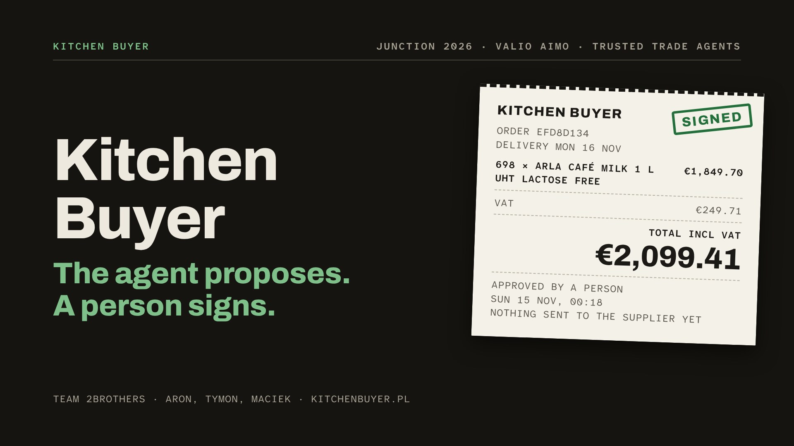
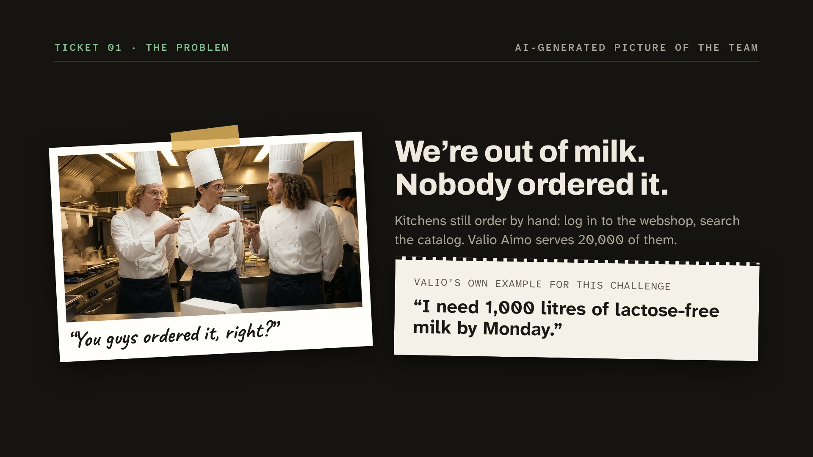
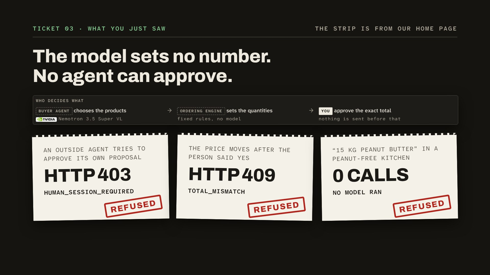
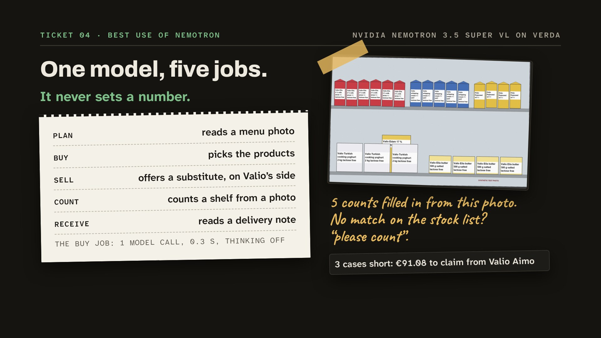
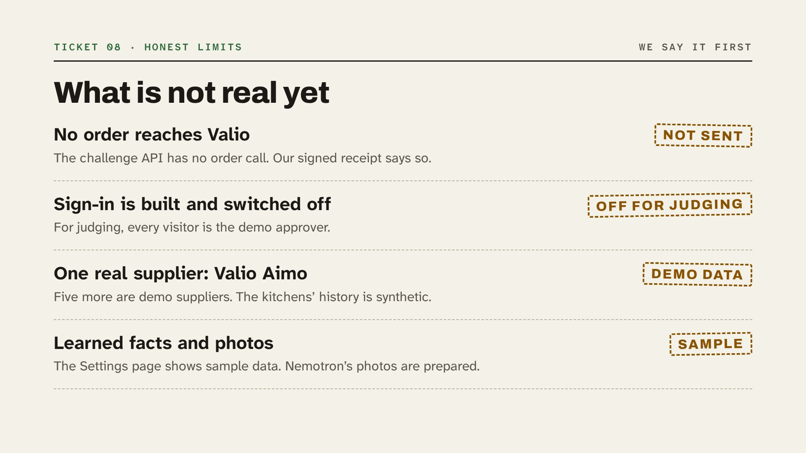
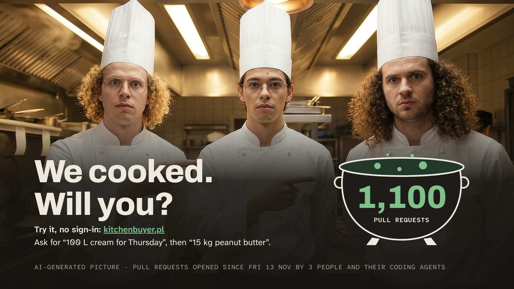

# Pitch deck

The deck we show at Junction 2026 after the demo video. Twelve slides: a cover, the problem (only
before a live demo), eight slides for what the video has no time for, and two backup pictures.

- **All slides in one file:** [`kitchen-buyer-pitch.pdf`](kitchen-buyer-pitch.pdf) (works offline).
- **Demo video, 1:57:** <https://youtu.be/7Wu0xuCiUHI>
- **Live site:** <https://kitchenbuyer.pl> (the old address <https://31-22-104-201.sslip.io> keeps working).
- **Demo script:** [`../demo.md`](../demo.md). **Form text and the source of every claim:** [`../submission.md`](../submission.md).

The slides were made on 15 Nov 2026 between 03:00 and 04:30 Helsinki. Prices, stock and counts on
the live site move, so read today's numbers from the screen.

## The run: five minutes per visitor

| Time | What |
|---|---|
| 0:00 | Slide 1. "Hi, we are 2BROTHERS, this is Kitchen Buyer. Two minutes of video first." |
| 0:10 | The demo video, 1:57. Say nothing. |
| 2:10 | "Here is what the video had no time for." |
| 2:15 | Five slides, about 1 minute 30: 3 (Valio), 4 (the rule), 8 (open), 9 (honest), 10 (close) |
| 3:45 | A question, or the visitor tries the site |

- Skip slide 2: the video opens with the same scene. Use it only before a live demo.
- NVIDIA judges: add slides 5 and 6. MongoDB judges: add slide 7. All eight slides take 2 minutes
  40 and leave no time for a question.
- If the time is cut: slide 9, then slide 10.
- A judge who wants it live: `docs/demo.md`, story A, with slide 2 before it.

One word per slide is enough to remember the order: **Valio, Rule, Five, Measured, Atlas, Open,
Honest, Close.**

Two facts to say the same way everywhere:

- The audit log is tamper-evident: a changed entry or a truncated end is detected. The head is not
  signed yet (#1886), so do not say "anchored".
- An order is recorded, never "sent": nothing goes to the supplier.

## The slides and what to say

### 1. Cover

> Hi, we are 2BROTHERS, and this is Kitchen Buyer. An agent proposes the order. A person signs it.
> Two minutes of video first.

The ticket is the real order of 15 Nov: 698 pieces of lactose-free milk, EUR 2,099.41, signed at
00:18, nothing sent to the supplier.

### 2. The problem (only before a live demo)

> Sunday night. The kitchen is out of milk, and everybody thought somebody else ordered it. Today a
> buyer logs into a webshop and searches a catalog by hand. Valio Aimo serves twenty thousand
> kitchens that work like this. And Valio asked one thing: let an agent do the buying, safely and
> in the open, before somebody else's platform decides how. This is their own example. Let me type
> it.

The picture of the three of us is AI-generated; it is a frame of the clip that opens the video.

### 3. VALIO: what Valio gets

> The video showed the kitchen's side. This is Valio's side. A kitchen can share its forecast with
> Valio, or not. Then Valio sees the demand against its own stock, before any order comes in. Five
> products short next week, and Valio knows on Sunday.

For a Valio judge, add: its own agent then offers a substitute first, and the same open interface
could serve any wholesaler and its kitchens. If asked: the demand comes from 20 demo kitchens with
a synthetic history, which is why the amounts are large. Valio Aimo is the only real supplier
today, so "any wholesaler" is the next step and not built; that is why its stamp is dashed.

### 4. RULE: what you just saw

> The rule behind everything you saw. The model picks the products. Code sets every number. A
> person approves the exact total. And code refuses three things: an agent approving its own order,
> a price that moved, and peanuts in a peanut-free kitchen.

### 5. FIVE: Nemotron's jobs

> One model, five jobs. It plans from a menu photo. It buys. It sells, on Valio's side. It counts a
> shelf from a photo. And it reads a delivery note. What it cannot match, it does not guess. And it
> never sets a quantity or a price.

What the shelf screen shows: the model read seven packs and five counts were filled in; one pack it
read as "Valio Edam 17 %" matched nothing on the stock list, so its row says "please count". The
photos are prepared test photos. We did not train or fine-tune the model.

### 6. MEASURED: how we improved its output

> We measured before we tuned. One request was four model calls and 43,500 prompt tokens. Now it is
> one call and 742. A better prompt took the model's exact picks from 27 to 54 out of 90, and a
> code guard took them to 69. And a simulated chef corrects 41 percent less.

Point at each row as you say its number. This slide counts prompt tokens per request (the old tool
loop against one pick). The video's "almost eight times fewer tokens" counts completion tokens on
the old loop, 2,251 to 289. Small samples: three live requests per row for calls and tokens; the
30-request set is a development set, not held-out; the chef is synthetic. Thinking is off in the
product, because the model sets no number there; it was on only in our benchmark, where we let the
model set numbers to compare it with the engine.

### 7. ATLAS: MongoDB Atlas

> All of it runs on MongoDB Atlas. The catalog search is Atlas Search over 17,546 products. The
> inbox fills live, over a change stream. The audit log is hash-chained. And no order is ever
> stored twice.

Say "stored twice", not "sent twice". Say "even with a typo" only if you type the typo in front of
them (`lactose fre milk` in the Catalog). If asked: vector search is real and sits behind the
Catalog switch; the Buyer searches by words and uses the vectors only when the words find nothing.

### 8. OPEN: any client can be the buyer

> It is open. Any agent can connect over MCP or REST. It can search and propose. It cannot approve.
> And the cook can just talk to a Telegram bot. It heard "oak drink", and it still proposed the oat
> drink.

### 9. HONEST: the limits

> What is not real yet. No order reaches Valio, because their test API has no order call. Sign-in
> is built and switched off for judging. And Valio is the only real supplier; the rest is demo
> data.

Never skip this slide.

### 10. CLOSE: the ask

> So: the agent proposes, a person signs. Three of us and our coding agents cooked eleven hundred
> pull requests in two days. Now you. Open kitchenbuyer dot P L, ask for a hundred litres of cream,
> and try to make the agent approve it.

- Invite cream, oat drink, chicken breast, cheese or lactose-free milk; the request page has
  example buttons. Do not invite butter, eggs or salmon as a free request: those three still give
  the wrong kind of product (`docs/demo.md`). "15 kg peanut butter" is safe: it is refused before
  any product is picked.
- 1,100 is pull requests opened, rounded: on 15 Nov at 02:26 Helsinki GitHub counted 1,111 opened,
  of which 988 merged. Do not say "merged" for 1,100. Count again:
  `gh api "search/issues?q=repo:Afro666/2Brothers+is:pr" --jq .total_count`.
- If asked who wrote them: three people and their coding agents; one task is one issue and one
  pull request, and every pull request gets an automatic review before it merges.

### 11 and 12. Backup

Slide 11 is the milk request as one picture: 698 L confirmed, 302 L waits, EUR 2,099.41 approved.
By hand in a webshop we estimate five to ten minutes for this order; that is an estimate, nobody
timed it. Slide 12 is the signed receipt and the hash-chained log.

## Questions a visitor may ask

- **Does it really order?** It records a signed order. Valio's test API has no order call, so
  nothing is sent, and the receipt says so.
- **Why not let the model set quantities?** We measured it: no model reached our engine on the
  benchmark, so the engine keeps the numbers.
- **What if the model is wrong or down?** A wrong pick cannot become a wrong order: code sizes it
  and a person approves. If the model is down, a plain parser answers and the card says so.
- **What is real?** Valio's prices, stock and catalog are their challenge data, read live. The
  kitchens' history and the other suppliers are demo data.
- **What next?** A real order call from Valio, and the same interface for other wholesalers.

## The source

`src/` holds the deck as it was written: `deck.json` (the order of the slides and the typefaces),
`deck.css` (the look) and one HTML file per slide in `src/slides/`. Each slide's `<aside>` holds
the full speaker notes with the source of every number on it. The deck was built as a Claude Slides
artifact, where pictures are stored by id; the same pictures are in `src/img/`:

| In the slide HTML | File in `src/img/` | What it is |
|---|---|---|
| `/_blob/fdcd43d5…` | `d-point.jpg` | AI-generated picture of the team, slide 2 |
| `/_blob/6a4c0de2…` | `d-demand.png` | The live Demand page, 15 Nov 02:47 |
| `/_blob/a0cc9bb4…` | `d-homestrip.png` | "Who decides what" from the Home page |
| `/_blob/5088f999…` | `d-shelf.png` | The prepared shelf test photo |
| `/_blob/bb021e02…` | `d-noteline.png` | The delivery claim line |
| `/_blob/67e4cbdc…` | `d-trustline.png` | The tamper check result, 15 Nov 02:47 |
| `/_blob/96af32ce…` | `telegram.png` | The Telegram bot, 14 Nov 20:27 |
| `/_blob/23deeb79…` | `cooks.jpg` | AI-generated picture of the team, slide 10 |
| `/_blob/2b4d4f59…` | `option-a.png` | The milk proposal card, 15 Nov 00:03 |
| `/_blob/b32bdeac…` | `receipt.png` | The signed receipt, 15 Nov 00:18 |

The look follows the product's own design direction: paper dockets, printer type, stamps, and
dashed ochre for what is not there yet.
